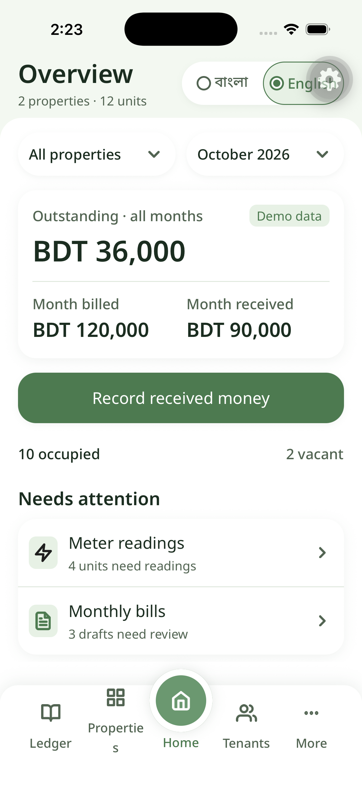
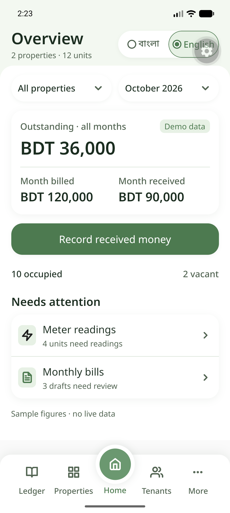

# Step 3 — SQLite language preference evidence

## Scope

This checkpoint stores one device-local choice only: `bn` or `en` for the current installation. It does not introduce property, tenant, tenancy, bill, payment, authentication, backup, synchronization, or a standalone APK.

## Automated checks

Executed from `mobile-app/` with Node 22.23.1:

```sh
npm run typecheck
npm test
```

Result: TypeScript passed. All nine tests passed: four existing Home/formatting tests plus five real-SQLite migration/preference tests. The test runner prints Node's experimental `node:sqlite` warning and module-type inference warning; neither is a test failure.

`npm run check:dependencies` reported dependencies up to date using Expo's local dependency map because network access was disabled. Treat that fallback as a compatibility indication, not a networked registry verification.

## Native rebuild and restart proof

Adding `expo-sqlite` required new native development builds. Both builds included the module and completed successfully:

- **iOS:** iPhone 17 Pro, iOS 26.5. English was selected, then `com.houserenttracker.preview` was terminated and relaunched through `xcrun simctl`. Home reopened in English, with English selected in the radio group.
- **Android:** Pixel_6 emulator. English was selected, then the package was force-stopped and launched through ADB. Home reopened in English, with English selected in the radio group.





## Limits

This is per-installation SQLite persistence in Metro-connected development clients. Uninstalling the app or clearing its data can remove the database. The result does not prove a physical Android installation, independent offline launch, account-level settings, backup/restore, synchronization, or reliability of future financial records.
